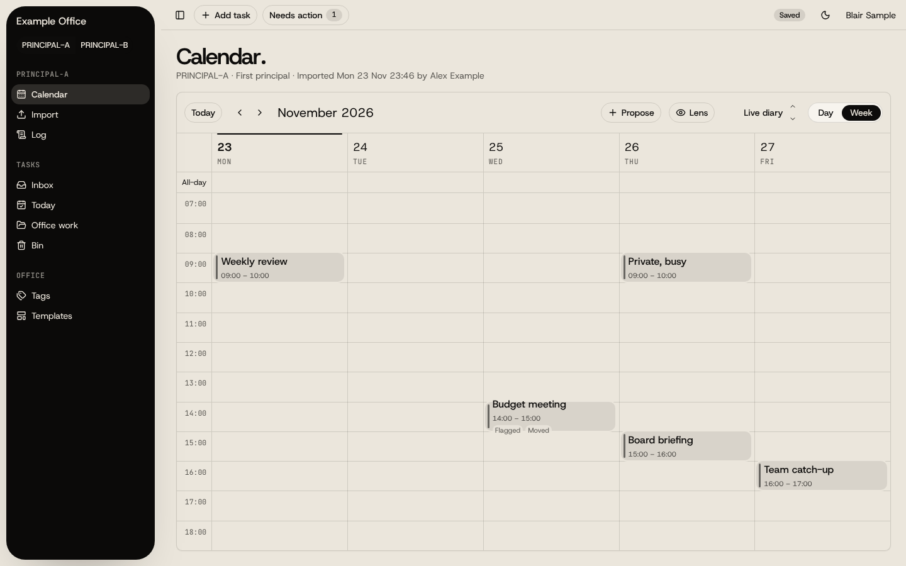
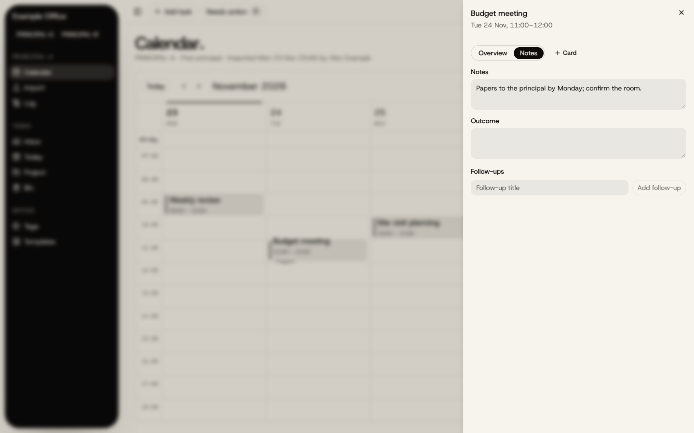
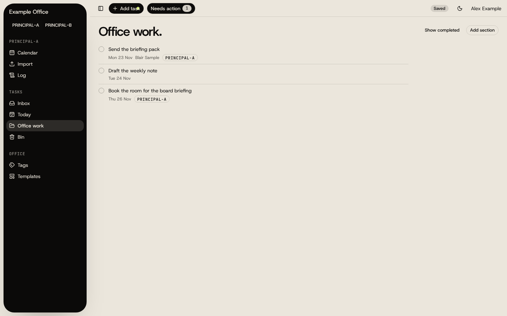
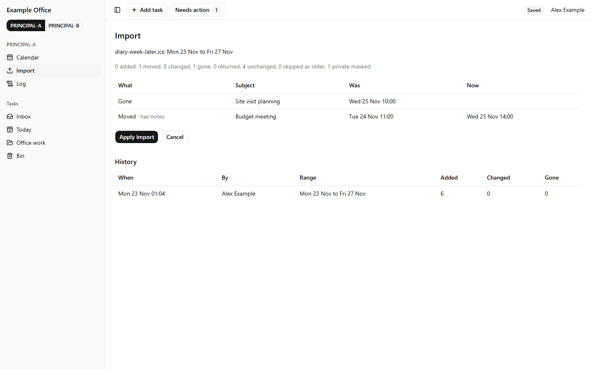

# Outer Office

A control panel for the private office of one or more senior principals. It reads each principal's Outlook calendar from an exported `.ics` file, lets the office add its own layer of preparation on top, and gives each user a small task manager.

It is one HTML file that people open from a shared folder. There is no server. Data is encrypted and syncs through the folder.

**Status: version 0.1.0.** A first working slice. Read [What is not in 0.1](#what-is-not-in-01) and [Not yet verified](#not-yet-verified) before relying on it.

## What it does

- **Diary.** Import a principal's calendar from an `.ics` file saved from Outlook. Review what will change before applying it. Outlook stays the source of truth: the app never edits an imported event and never writes to Outlook.
- **Preparation.** Open an engagement to flag it, set its prep state and owner, and keep notes and an outcome. These survive every later import, including when the meeting moves.
- **Tasks.** An Inbox and a Today list for each user, and one shared project with sections. Add a task in one line (`Draft the note fri #Office work p2 +Sam ^PRINCIPAL-A {27 nov}`), assign it, and follow it through offered, accepted and declined.
- **Needs action.** For the chosen principal: tagged tasks that are overdue or due today, engagements in the next 24 hours that still need prep, and engagements that have gone from Outlook but have office notes.
- **Log.** Every change to a principal's diary and tagged tasks, newest first.
- **Several principals.** A switch in the sidebar chooses whose diary, imports and log you see. Tasks are everyone's own and do not follow the switch.
- **Set up from the admin page.** The office's name, time zone, working day, how private items are treated, the list of principals, and who is a viewer.

## Screenshots

Taken by `npm run two-users` from the built files, with synthetic data.

The week's diary, with the office's marks on each engagement:



An engagement's Prep tab, where the office keeps its state, owner and notes:



The shared project's tasks:



Reviewing a second import before applying it: one meeting has moved and keeps its notes, another has gone:



## How it is built

- **[Trellis](https://github.com/harry-burton-dev/single-file-web-apps)**, a small framework for team apps that sync through a shared folder. This repository carries its own copy in `framework/`, with the changes listed below.
- **React 19, Tailwind 4 and shadcn/ui**, default neutral theme.
- **FullCalendar 7** in its forma flavour, through its shadcn integration. Read-only: the drag-and-drop plugin is not loaded.
- **ical.js** to read `.ics` files.

```text
app/app.config.ts        the tables
app/src/domain/          commands, selectors, quick-add parser, date helpers
app/src/import/          the .ics parser and the diff
app/src/calendar/        the read-only diary calendar
app/src/app/             the frame: sidebar, top bar, state
app/src/screens/         calendar, import, log, task lists
app/src/panels/          engagement, task, needs action
app/src/dialogs/         quick add, privacy notice
app/src/admin/           this app's sections of the admin page
framework/               Trellis: sync engine, data layer, shell, admin page, build
design/                  the build brief and the design brief
docs/                    Trellis's own documentation
```

`design/v0.1-brief.md` is the specification the code was written against. `design/design-brief.md` holds the ten design limits the screens are checked against.

## Run it

Node 22.18 or later.

```sh
npm ci
npm run dev
```

To build the files that go in the shared folder, the page needs a public signing key. For a local build a throwaway one will do:

```sh
export TRELLIS_PUBLIC_KEY="$(npm run --silent keygen | sed -n 's/^TRELLIS_PUBLIC_KEY=//p')"
npm run build
```

`dist/` then holds the page people open, the admin page, and the app as one file.

### Checks

```sh
npm run typecheck
npm test            # engine, runtime, data, framework, shell and app suites
npm run probes      # adversarial tests of the sync engine
npm run two-users   # the admin page and two users on one folder, from built files, with an accessibility scan
npm run smoke       # the built page and admin page opened from disk: signed updates, enrolling, backup and restore
```

The last two need Playwright: `npm install --no-save playwright @axe-core/playwright && npx playwright install chromium`.

On Windows, three framework tests fail for file-path reasons, and `npm test` stops at the first failing suite. `docs/explanation/limits.md` lists them and how to run the suites one at a time. CI runs on Linux, where all of them pass.

## Release it

Releases are signed. Whoever holds the signing key can ship code to every user, so no key is in this repository and none has been made for it.

1. Run `npm run keygen` once. It prints a public key and a signing key.
2. In the GitHub repository's Actions settings, store the public key as the **variable** `TRELLIS_PUBLIC_KEY` and the signing key as the **secret** `TRELLIS_SIGNING_KEY`. Keep a backup of the signing key somewhere safe.
3. Push a tag: `git tag v0.1.0 && git push origin v0.1.0`. The release workflow tests, builds, signs and publishes a zip to copy into the shared folder.

`docs/guides/release.md` has the detail, and `docs/guides/invite-a-user.md` covers creating the workspace and inviting people.

## Privacy and security

- Everything in the shared folder is encrypted with one key per workspace. Anyone invited to the workspace holds that key.
- **Tasks are hidden, not secret.** A user's Inbox is hidden from colleagues on screen, and readable by anyone holding the workspace key. Each user is told this once.
- **Viewer mode is not a security control.** It hides the editing controls.
- **The exported `.ics` file is not encrypted.** The import screen reminds you to delete it.
- Private Outlook items are masked as "Private, busy", or dropped, before anything is stored. The office chooses which.
- **Power Automate files are not encrypted.** With the Power Automate setting on, diary updates arrive as plain files in `automate/`. Anyone with access to the shared folder can read them, even without the workspace key, and can write files there for the app to read. Private items are masked by the flow before they are written, meeting bodies are never included, and the flow deletes files older than 48 hours. The setting is off until an admin turns it on.
- Removed content stays in older files in the folder, and in the sync tool's version history.

## What is not in 0.1

Designed and not built: a home page of what changed with rules each user sets; proposed engagements and an archive with reasons; saved calendar views; exports; meeting templates and checklists; attendees and their responses; labels, comments, files, saved filters; sharing a project by role; a board view; stats; the month view.

## Changes to the framework

This copy of Trellis differs from the upstream repository in these ways:

- `TrellisApp` has a `width` prop (`"narrow"` or `"wide"`) and a `chrome` prop (`"shell"` or `"app"`). With `chrome="app"` the app lays out the running page itself and places `HealthIndicator` and `ConflictPrompt`, which are now exported, along with `useSession`.
- `HealthIndicator` has a `compact` mode.
- `useUsers` gives an app the workspace's users and their names.
- The admin page takes sections from the app (`app/src/admin/index.ts`), see `docs/guides/add-an-admin-panel.md`.
- The boundary check treats tests, `testing/` and `spike/` folders as not shipped, and stops shipped code importing them.
- Apps can keep plain, unencrypted files in one subfolder of the shared folder, for tools such as Power Automate: `useSession().plainFiles(folder)` lists, reads, writes and deletes them, and `useSession().onTick(listener)` runs app work after each sync tick. The boundary check stops shipped app code using the folder handle directly. See `docs/guides/read-and-write-plain-files.md`.
- The bundle size budget is 1,400,000 bytes (the framework's own is 500,000). Version 0.1 is about 1,180,000 bytes, 344,000 compressed.

## Not yet verified

- **A real shared folder.** Everything is tested against an in-memory or stand-in folder. It has not been run on a real OneDrive or SharePoint folder on a managed computer, where browser policy can also switch off folder access.
- **A real Outlook export.** The `.ics` parser is tested against synthetic files shaped like Outlook's. Known gaps: a Windows time-zone name with no definition in the file falls back to the office's zone; "this and future" changes to a series are treated as a single instance.
- **Real users.** Nobody has done a day's work on it.
- **Dark mode** and narrow windows have not been looked at.

## Licence

MIT. See [LICENSE](LICENSE). FullCalendar's standard packages, ical.js, React and shadcn/ui are also MIT.

Made with the Trellis framework.
